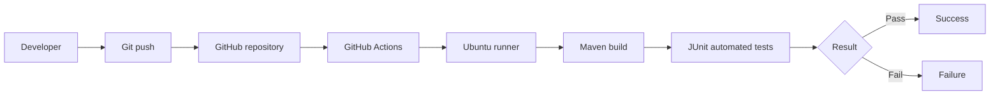

# Inventory Manager — 24CSE538 Cloud DevOps

## Objective

Demonstrate Continuous Integration for a Java application: every push triggers a Maven build and JUnit test run on GitHub Actions. This project does not deploy the application.

## Application

Inventory Manager tracks named items, available quantities, and unit prices. Its operations add an item, add stock, remove stock, look up quantity, and calculate total inventory value. It rejects invalid quantities, duplicate item names, and stock removals that exceed available quantity.

## Project structure

```text
inventory-manager/
├── .github/workflows/ci.yml
├── src/
│   ├── main/java/edu/cse538/inventory/Inventory.java
│   └── test/java/edu/cse538/inventory/InventoryTest.java
├── pom.xml
└── mvnw
```

## Build and test locally

Java 17 or later is required. The Maven Wrapper downloads and runs the Maven version configured in `.mvn/wrapper/maven-wrapper.properties`, so a separate Maven installation is not needed.

```bash
./mvnw clean verify
```

The JUnit suite covers increasing stock, decreasing stock, inventory valuation, over-removal rejection, and duplicate-item rejection. Maven reports the test count and build result in the terminal; successful execution ends with `BUILD SUCCESS`.

## GitHub Actions CI workflow

The workflow at `.github/workflows/ci.yml` runs for every push (and can also be started manually). It checks out the source, configures Temurin Java 17 with Maven dependency caching, then runs `./mvnw --batch-mode --no-transfer-progress clean verify` on `ubuntu-latest`. A test or build failure makes the job fail; all passing steps produce a successful workflow run.

## CI pipeline diagram



## Short answers

1. **What is Continuous Integration?** CI is the practice of frequently integrating code changes into a shared repository and automatically building and testing them, so defects are detected early.
2. **What is the purpose of `pom.xml`?** It describes the Maven project, Java/build settings, dependencies such as JUnit, and plugins used to compile and test the code.
3. **Why is a YAML workflow file required for GitHub Actions?** The YAML file declares event triggers, jobs, runners, and steps that GitHub Actions should execute.
4. **What is the purpose of a GitHub Actions runner?** A runner is the machine that checks out the repository and executes workflow commands and actions.
5. **What happens when an automated test fails inside CI?** Maven exits unsuccessfully, the workflow job is marked failed, and GitHub displays the failing test and logs so the issue can be fixed.
6. **Differentiate between `pom.xml` and the GitHub Actions YAML workflow.** `pom.xml` configures Maven's project build and test process; the workflow YAML tells GitHub when and where to run that process.
7. **Explain the complete flow of your CI pipeline from a code change to the final CI result.** A developer pushes a change; GitHub receives the push and starts the workflow on an Ubuntu runner. The runner checks out the code, installs/configures Java 17, and runs Maven `clean verify`. Maven compiles the code and runs JUnit tests, after which GitHub reports success or failure.
8. **Why is automated testing important in a CI pipeline?** Automated tests provide repeatable checks on each change, help catch regressions quickly, and give the team fast feedback before changes are integrated further.

## Submission evidence checklist

Before submitting the PDF, add your own screenshots for the project structure, source and test files, `pom.xml`, local Maven test output, Git initialization/commit, the published GitHub repository, workflow YAML, successful Actions run, and Actions test logs. Include the actual GitHub repository URL. Screenshots of the hosted repository and Actions run can only be captured after pushing this project to your own GitHub account.
